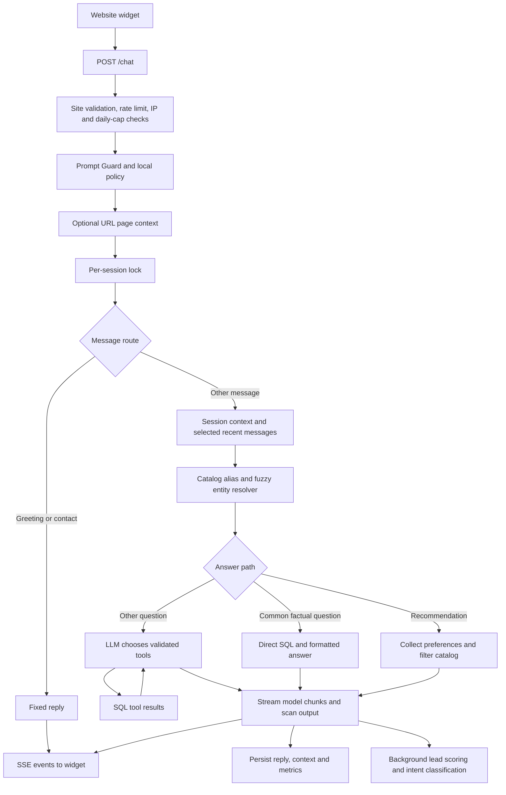

# DegreeBaba chatbot — codebase review

Reviewed 9 October 2026. Repository: `db-sde/chatbot`, branch `main`, commit `c7cc0a8d939ba5351515569d62ac3240c5cb619c`.

This is the original, pre-fix review. The subsequent local repairs and verification are recorded in [FIXES.md](FIXES.md); source line numbers below refer to the reviewed commit.

## Assessment

This is a catalog-backed education assistant and lead-capture application. It has useful foundations: parameterized SQL, async database access, direct routes for common questions, an LLM tool loop for other questions, persistent conversation context, an embeddable widget, and an administration dashboard.

I would not consider this checkout ready for a fresh production deployment. Local checks reproduced an unauthenticated file-read vulnerability, broken fresh-database ingestion, incorrect contextual course resolution, and incorrect budget parsing. The 140 offline tests pass, but these problems sit outside what those tests verify.

The application does not implement automatic model learning. It remembers selected conversation information and retrieves catalog records. Its knowledge changes when someone changes the catalog or application logic.

## Scope and verification

Reviewed the backend request handlers, graph, resolver, tool layer, provider abstraction, database queries and migration, security and lead modules, widget, React admin source, ingestion and seed utilities, deployment and CI configuration, tests/evaluation harness, and the separate `new/` modules. Existing audit documents were treated as historical descriptions, not proof of current behavior. Generated assets and lockfiles were inspected as build/dependency artifacts.

| Check | Result |
|---|---|
| Locked Python dependency installation | Successful with `uv sync --all-packages --frozen` |
| Offline tests | **140 passed** using `.venv/bin/python -m pytest tests --ignore=tests/test_tools_integration.py -q` |
| Database migration | Successful in an isolated local PostgreSQL 17.6 database with pgvector, pgcrypto and pg_trgm available |
| Existing database integration tests | **3 setup errors**, all caused by the missing `entity_search.embedding` column |
| Admin production build | Successful; output directed to `/private/tmp/chatbot-admin-review-build` to preserve committed assets |
| Admin lint | **4 errors**: one React effect rule in `Security.jsx`, three unused imports in `Settings.jsx` |
| Python compilation and widget JavaScript syntax | Successful |
| Focused behavior checks | Reproduced file-path escape, budget errors, incorrect session course selection, ignored second university, contact-negation errors, missing parent tool metrics, and first-message security logging failure |

The integration fixture hardcodes port 5433. Its connection check was redirected in memory to the isolated database on port 25433, with settings initialized to that database. Repository tests and application source were not edited. An initial combined test run hit sandbox socket restrictions; the subsequent database run established the actual schema failure above.

No production database, deployed endpoint, real student records, or paid LLM API was used. Consequently, this review does not establish production latency, throughput, actual catalog accuracy, or live model answer quality. The database image used for verification differs from Compose's PostgreSQL 16 image; the reproduced missing-column error is in the repository schema and SQL.

## How a message is handled

1. **The widget establishes a browser session.** `widget/widget.js:7` stores a random UUID in localStorage. It loads widget settings, lazily restores chat history when opened, and sends messages to `/chat`. It disables the composer during an active stream and suppresses rapid duplicate submissions.
2. **The HTTP layer gates the request.** `backend/main.py:200` validates the site/domain, starts safety scanning, evaluates local policy, and checks the IP blocklist and daily message count. Prompt Guard runs concurrently with independent database checks. The configured defaults are 10 chat requests per IP per minute and 2,000 stored messages per site per database day.
3. **Page context can be resolved.** `backend/agent/page_context.py` recognizes `/colleges/{university}/{course}/{specialization}` and verifies the slugs in SQL. The shipped widget currently does not send `page_pathname`, so this functionality is not connected end to end.
4. **The graph serializes each session.** `backend/agent/graph.py:1662` prevents simultaneous turns from changing one session's context within the same Python process. Greetings and contact requests take a fixed-response path after HTTP safety checks.
5. **Context and entities are loaded.** Simple factual routes skip raw chat history; other routes receive up to six recent messages, plus structured session context. The resolver uses catalog aliases, regex hints, and RapidFuzz matching to identify universities, courses and specializations. The current resolver does not require an LLM extraction call.
6. **Common facts bypass the main LLM.** `backend/agent/deterministic.py` formats SQL results for fees, eligibility, specializations, accreditation, programs, reviews and ratings. Program overviews also have a direct path. No aggregate numeric review score is stored, and the ratings route says so.
7. **Recommendations are a filter flow.** The active implementation asks for program, budget, study mode and specialization, then returns up to three catalog matches ordered by fee. It is not a learned ranking system or an assessment of individual career fit.
8. **Other questions use a tool-calling LLM.** The active default is Groq's `llama-3.3-70b-versatile`; OpenAI and DeepSeek alternatives exist in `backend/llm/config.py`. The model can call 12 tools for facts, discovery and comparisons. Tool arguments are validated and canonical resolver values can replace guessed slugs. Tools use parameterized SQL. The graph allows at most four tool rounds and eight actual tool calls per turn.
9. **Responses and lead signals are recorded.** The widget consumes SSE `token`, `replace` and `final` events. The server saves messages and structured context, returns action cards and optional contact prompts, and schedules lead scoring. The admin panel reads conversations, leads, security events, knowledge gaps and usage/cost statistics.

## What “learning” currently means

| Mechanism | Implemented behavior | Does it train the model? |
|---|---|---|
| Conversation history | Stored user/assistant messages; selected recent messages enter later prompts | No |
| Structured memory | Current university/course/specialization, comparison state, preference funnel and contact fields in `session_context` | No |
| Knowledge updates | JSON ingestion upserts catalog records and rebuilds text search entries; currently broken on a fresh schema | No |
| Entity cache | Catalog aliases and canonical slugs loaded into process memory at startup or `/api/admin/cache/refresh` | No |
| Lead intelligence | Fixed scoring rules and a small-model intent classification call | No |
| Unanswered questions | Some empty-answer failures are logged for staff to inspect | No |
| Fine-tuning or adaptive ranking | No application pipeline found for training, feedback-based model updates or learned ranking | Absent |
| Vector retrieval | pgvector extension and an unused `content_chunks` table exist; active retrieval is SQL/text matching | Absent from the answer path |

The external LLM brings its pretrained capabilities, but this application does not update its weights. A student chatting with it does not automatically teach later students new facts.

There is also no complete staff correction loop: the unanswered dashboard displays grouped questions, but it has no approve/edit/publish workflow that turns a corrected answer into catalog knowledge. Several “not available” responses do not call `log_unanswered`, so an empty gap dashboard does not prove complete knowledge.

The expanded intent classifier, lead detector, decision engine and qualification funnel under `new/` are not imported by the running backend. The live funnel is the smaller implementation in `backend/agent/resolve.py` and `graph.py`. Changes to `new/` alone will not affect `/chat`.

## How response time is handled

### Existing optimizations

| Optimization | Where it helps | Limitation |
|---|---|---|
| Direct factual routes and fixed greeting/contact replies | Avoid main-model planning and answer-generation calls | HTTP safety checks still run first; ordinary factual turns still schedule a background intent-model call |
| Warm entity cache | Resolves aliases/slugs without repeated catalog reads | No automatic TTL/invalidation; refresh is per process |
| Async PostgreSQL pool | Reuses 3 warm connections, up to 10 per process | No explicit query/acquisition deadline configured |
| Parallel independent reads | IP/cap checks; session creation/history/context reads | Other operations and context writes remain sequential |
| Parallel tool execution | LangGraph ToolNode can execute a batch concurrently | Task-local timing collection does not reliably reach the parent |
| Small conversation windows | Reduces prompt size and processing | Deterministic routes receive no raw history, making structured memory correctness essential |
| Streaming | The graph forwards model chunks through SSE | Direct SQL answers arrive as one completed chunk; live-provider TTFT was not measured |
| Background lead work | Keeps intent classification off the answer-generation path | Tasks compete for the same resources and are not a durable queue |
| Widget feedback | Immediate user bubble, animated waiting indicator and disabled composer | This changes perceived progress, not backend speed; no client abort deadline |

For a typical LLM/tool answer, work still occurs in sequence: initial model decision → database tools → model synthesis. A common catalog answer avoids that sequence. Streaming can reduce the wait to the first visible text, but does not shorten the total computation by itself.

### Remaining latency risks

- **Prompt Guard runs before every allowed reply**, including greetings and direct SQL answers when a Groq key is configured. Its configured timeout is two seconds per attempt, with one retry and 0.1 seconds backoff: approximately **4.1 seconds** before heuristic fallback on the full timeout path, excluding scheduling/cancellation overhead. A circuit breaker opens after repeated failures. Without a Groq key, it uses local heuristics even when the main provider is OpenAI or DeepSeek.
- **Main-model calls use a 60-second timeout.** Multiple model calls, provider retries, tools, lock waits and database work have no shared end-to-end deadline. The tool-call cap controls work count, not a response-time target.
- **Session serialization can queue a later request.** Locks are local to a worker. Multiple workers can still process the same session concurrently.
- **The semantic cache is a placeholder.** `node_triage` always returns `cache_hit=False`; there is no implemented answer cache.
- **Some post-answer database writes delay `final`.** The browser can see text while assistant persistence and profile updates are still running. The composer is re-enabled only when the stream ends.
- **No SSE heartbeat or explicit browser timeout exists.** A stalled request can leave the widget waiting. The graph fallback can rerun the whole graph if the final graph state is missing.
- **Security-event logging can make a one-second external geolocation request**, followed by several SQL reads, before the blocked response is sent.

### Metrics need correction before trusting the dashboard

The code records response time, first visible SSE latency, LLM time, tool time, tokens and estimated cost. Those are useful starting points, but their definitions differ:

- Persisted `response_time_ms` starts inside the unlocked graph turn, after HTTP checks and session-lock waiting. It is calculated before assistant/profile persistence. It is not complete browser request latency.
- Persisted factual-turn `ttft_ms` includes the supplied HTTP request start. The HTTP handler also logs a request timing tree, but does not persist that entire tree in the messages table.
- Greeting/contact SSE metrics are hardcoded to zero; their saved message rows omit those metrics. Those zero values do not mean the actual HTTP request was instantaneous.
- A real ToolNode probe executed a tool successfully while the parent `tool_metrics_var` remained `[]`. Setting a ContextVar list in a child task does not merge it into the parent. Per-tool duration/status logs can therefore be missing even when the aggregate graph tool time exists.
- Direct-route timing may be recorded internally, but there is no corresponding LLM tool-call entry for the admin SQL analytics to aggregate.
- Guard usage is not recorded through `record_llm_call`; background classifier usage has no separately persisted cost record. The displayed cost is not a reliable total provider bill. Model prices are static estimates in code.
- Request timing-tree components overlap because safety and prechecks run concurrently. Summing component times is not the same as elapsed wall time.
- Analytics expose averages, not p50/p95/p99, route breakdowns, queue wait or reliable failure/time-out rates. Multiple leads per session can multiply message costs in joined analytics queries.

There is no defensible production “X seconds per reply” figure from this checkout alone. Measure HTTP first text and completion at realistic concurrency, split by direct/LLM route, warm/cold state and provider failure path.

## Findings, ordered by impact

### 1. Critical — unauthenticated arbitrary file read

`backend/main.py:558` joins attacker-controlled `path_name` directly to `admin_dist_path`, checks whether the resulting file exists, then returns it. It neither resolves and checks containment nor requires authentication.

**Local proof:** an unauthenticated TestClient GET to `/admin/..%2F..%2FREADME.md` returned **200** and the repository README outside `admin/dist`. This was tested only with that benign file. Other server-readable files could also be exposed, including secrets if present and accessible.

**Repair:** use a static-files implementation that enforces directory containment, or reject resolved paths outside the static root before serving. Keep the SPA fallback separate. Add traversal regression coverage.

### 2. High — fresh ingestion and integration fixtures fail

`ingestion/microapp_to_db.py:62` writes `embedding = NULL` in its conflict-update statement, but `backend/db/migrations/0001_init.sql:177` defines `entity_search` without an embedding column. PostgreSQL validates the statement even on an initial insert.

**Database proof:** migration succeeded; sample-university ingestion raised `UndefinedColumnError`. All three existing integration tests stopped at this fixture step. The ingestion transaction rolls back.

**Repair:** make the schema and ingestion statement agree. Since embeddings are not used by the active implementation, decide explicitly whether to remove the stale assignment or introduce the intended vector schema.

### 3. High — documented Docker deployment is inconsistent

Compose builds `./backend`, but `backend/Dockerfile:9` copies `uv.lock`, which exists only at the repository root. The build context cannot supply it. The image also does not include the repository-level widget or React admin assets, while `main.py` expects them one directory above the backend. The bind mount over `/app` can obscure a virtual environment created there during image build. The example environment uses `localhost`, whereas the API container needs the database service hostname `db`.

**Evidence:** file/build-context inspection; a full image build was not run.

**Repair:** use a coherent repository-root build context, explicitly package backend, lockfile and public assets, place the environment where mounts cannot hide it, and provide a container-specific database URL and readiness check.

### 4. High — contextual course resolution can pair different universities

`backend/agent/resolve.py:1279` snaps the course before applying session/page university context at line 1392. With no explicit university in the message, course snapping searches globally. Session context is applied later without resnapping a course already found.

**Local proof:** with NMIMS and Sharda MBA records and saved university `sharda`, `MBA fees` resolved to university **sharda** and course **nmims-mba**. Naming `Sharda MBA fees` explicitly selected the correct course. SQL scoping can then return a false “not listed”; course-only tool paths can use the wrong course.

Global fallback in `snap_course`/`snap_specialization` can also return another institution's record when a scoped match is absent. `node_resolve_entities` persists entity updates only for status `resolved`, so some session/page-context course changes are not saved for later turns.

**Repair:** establish the effective university/course context before matching dependents; enforce parent-child consistency and persist valid context changes regardless of how the university was obtained.

### 5. High — normal Indian budget notation is parsed incorrectly

`backend/agent/resolve.py:436` captures digits but not units or decimal amounts. `_qualification_budget` accepts that incorrect `max_fee` before trying its unit-aware logic.

**Local proof:** `MBA under 2 lakh` → **2.0**; `MBA under 200k` → **200.0**; `Recommend MBA under 2 lakh` → **2.0**. This produces empty or inappropriate recommendations.

**Repair:** use one shared money parser for initial questions and funnel answers, including ₹, commas, decimals, k/thousand and lakh/lac. The separate ingestion money parser also strips units and needs a documented accepted input format or the same normalization.

### 6. High — default admin credential remains accepted

`backend/settings.py:25` defaults to `change-me`, and startup validates the active LLM key but does not reject the default admin token. The example environment repeats it.

**Evidence:** clean-checkout settings retain that value. This does not establish the deployed service's token.

**Repair:** require a non-default secret at startup. The current single shared bearer token also provides no individual account attribution or role separation.

### 7. High — lead capture and CRM delivery have inconsistent success semantics

- `widget/widget.js:525` shows a successful callback confirmation before the request completes and never checks its HTTP status.
- `/webhook/lead` posts to the CRM synchronously with an eight-second timeout, does not check the CRM status, and has no durable delivery/retry record. A CRM 500 can still lead to `{ok:true}`; a transport failure after the database insert can instead make the browser retry and create duplicates.
- The progressive path saves a lead only when **name, phone and email** all exist (`backend/db/queries.py:250`). A student who shares a usable callback number but skips email remains outside the leads table.
- Progressive lead creation does not send the CRM webhook. The newer contact path prompts for progressive fields, making this gap directly relevant to callback requests.
- Progressive contact saves are read/modify/write operations without the chat session lock or an atomic JSON merge, so concurrent chat/profile writes can lose fields.
- Settings report CRM delivery as “Success” merely when a webhook URL is configured (`backend/main.py:799`), without checking delivery history.
- The active contact detector treats negated requests as positive intent. Local checks returned `True` for both “Do not call me” and “I don't want a callback”; an informational question mentioning counselling also triggered contact intent.

**Repair:** define minimum contact requirements, share a single lead-creation service, acknowledge only confirmed saves, enforce idempotency, and use a durable CRM outbox with retry and actual delivery status.

### 8. High — safety logging fails for a blocked first message

The guard/policy paths insert into `flagged_messages` before `ensure_session` creates the session. That table has a foreign key to `sessions`.

**Database proof:** inserting a flag for a new synthetic session raised `ForeignKeyViolationError`. In `/chat`, this reaches the broad stream exception handler before the intended security-event write and rejection response. Repeated first-message attacks can therefore avoid the normal event/auto-ban accounting.

**Repair:** establish a correctly site-scoped session before writing dependent moderation rows, or decouple ingress-security records from chat-session existence. Moderation logging failure should not replace the security decision.

### 9. Medium — direct routes can silently ignore requested scope

`detect_route('NMIMS and Sharda fees')` returns `fee`; the resolver finds both institutions, but `run_deterministic_route` reads only `resolved.university_slug` and ignores `comparison_targets`.

**Local proof:** a direct-route probe returned only the first university's fee. Similar care is needed for other multi-entity routes. The recommendation flow's “Compare these programs” action does not save the recommended course shortlist as structured comparison targets.

**Repair:** permit single-entity templates only when the question is single-entity, or explicitly handle all targets. Persist shortlisted course IDs/slugs for later comparison and eligibility requests.

### 10. Medium — widget page context is disconnected

`widget/widget.js:694` sends only `page_university_slug`; its fallback at line 5 is the final URL segment. On a nested course page that can be a course or specialization slug. The verified pathname parser and course/spec page context therefore are not populated by the widget. Even when a caller sends pathname context, entity resolution receives only the university hint; deterministic routes do not directly consume the page course/spec fields.

**Repair:** send `location.pathname`, propagate the verified complete page context into resolution, and define when page navigation overrides an older conversation anchor.

### 11. Medium — output replacement does not guarantee prevention of leaks

`backend/agent/graph.py:1376` scans a trailing window before forwarding each chunk, then scans the full response. Detection can send `replace`, and the widget replaces the displayed bubble, but already transmitted bytes remain with the client.

**Local check:** a partial marker was clean while its completed form was rejected. This demonstrates that full-output pattern checks cannot classify every earlier partial prefix. Regex checks also do not establish factual grounding.

**Repair:** choose an explicit buffering/stream-safety policy and document its guarantees. Avoid treating a later replacement as erasing earlier disclosure. Never put credentials into model context.

### 12. Medium — knowledge-gap collection and answer trust are incomplete

Deterministic “not listed” answers, unknown-entity replies and tool-gap responses can return text without logging a knowledge gap; only the empty-response fallback reliably calls `log_unanswered`. The admin's “Zero Gaps Detected” description consequently overstates coverage.

`seed_database.py:6` explicitly generates synthetic catalog facts, reviews and analytics. If that data is used for real students, the bot can faithfully repeat invented facts while calling them verified. I did not inspect the deployed database, so its data origin is unknown. Seed data also cannot establish production response-time statistics.

**Repair:** log gaps as structured outcomes on every route, separate demo records from approved production data, and retain source URL, verification date and approval/provenance metadata for student-facing claims.

### 13. Medium — scaling, limits and operational visibility need work

- SlowAPI uses local in-memory state by default (`backend/rate_limit.py`); it is not a shared multi-worker limit. Session locks, caches and safety circuit/session state are also per process.
- The daily cap is a count-then-act check, not an atomic reservation. It counts both user and assistant rows, so 2,000 “messages” is roughly 1,000 successful two-message exchanges, not 2,000 questions. Concurrent requests can overshoot, and blocked requests need not create message rows.
- Origin/Referer checks constrain normal browser use but are forgeable by non-browser clients. The default domain list permits broad Render subdomains; literal wildcard origins in the CORS list do not provide wildcard browser matching.
- Background tasks are retained in memory, but have no durable queue, backpressure or shutdown-drain protocol. Restarts can lose analytics/classifications, and multiple turns can complete background session updates out of order.
- `/health` always returns success without checking database/provider readiness. Startup reruns the consolidated initial migration; existing-schema indexes can be attempted before required delta columns are added. Versioned migrations need clearer upgrade discipline.
- NAAC filtering compares grade strings lexicographically (`c.naac_grade >= $4`), not by an explicit grade rank.
- Admin conversation search covers only its fetched default batch of 50 sessions; leads fetch only 200 records before client-side pagination. Most admin fetches run on mount/manual refresh, despite some “live” UI copy.
- Runtime/admin dependencies include several unused legacy provider packages; `backend/requirements.txt` disagrees with the workspace dependency declarations and omits active provider packages. Fresh-backend packaging declares a nonexistent backend `README.md`.
- Student message excerpts and tool arguments can enter application logs. There is no implemented retention/deletion workflow in this checkout. Admin-configured lead-form title/description are interpolated into HTML without escaping, unlike normal chat markdown.

## Recommended implementation order

1. **Close the file-read vulnerability and enforce a non-default admin secret.** Verify with local negative/positive file-serving tests.
2. **Restore reproducible startup and data loading.** Fix build context/assets/environment placement, reconcile migration and ingestion, and require a fresh-database integration job in CI. Use only reviewed production catalog records.
3. **Fix answer correctness.** Unify money parsing; scope courses/specs to effective university context; preserve multi-entity targets and recommended shortlists; connect widget pathname context.
4. **Make lead delivery reliable.** Align progressive/full forms, minimum contact fields, save acknowledgements, idempotency and CRM outbox delivery. Correct negated contact intent such as “Do not call me”.
5. **Correct telemetry, then set latency budgets.** Persist complete HTTP TTFT/completion/queue time, explicit per-tool result metrics and separately attributed background/guard usage. Report percentiles and route/error breakdowns. Add end-to-end and database deadlines, disconnect cancellation and stream heartbeats.
6. **Build an explicit knowledge-improvement workflow.** Structured gap capture → staff correction → approved catalog update → cache invalidation → regression evaluation. Consider semantic retrieval only when unstructured content requires it; training is a separate decision and is not needed merely to keep fees current.
7. **Prepare for multiple workers.** Shared rate limiting, session concurrency controls, consistent cache invalidation and durable background work, backed by load tests that include provider outages and database contention.

These are proposed repairs. This review imported the repository, installed dependencies, performed verification, and added this report; application code was not changed.
